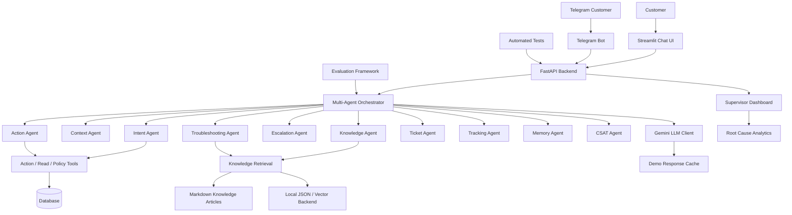

<div align="center">

# ResolveAI

### Agentic customer support for e-commerce

ResolveAI brings together specialized AI agents, verified customer and order data,
and a curated knowledge base to help support teams investigate issues, guide
customers, take policy-based actions, and escalate cases with context.

[](https://www.python.org/)
[](https://fastapi.tiangolo.com/)
[](https://streamlit.io/)
[](https://www.sqlite.org/)
[](https://ai.google.dev/)
[](LICENSE)

</div>

---

## What it does

- **Understands support requests** with dedicated agents for intent, context,
  knowledge selection, and troubleshooting.
- **Uses customer and order context** from a local SQLite database alongside a
  Markdown knowledge base.
- **Takes policy-guided actions** through deterministic tools, rather than asking
  the language model to execute database changes directly.
- **Keeps conversations explainable** with multi-turn memory and a visible trace
  of agent steps.
- **Escalates with useful context**, creating support tickets and tracking ticket
  lifecycle, SLA risk, and customer feedback.
- **Provides a support console** with a Streamlit chat and supervisor dashboard.
- **Supports repeatable demos** with scripted customer scenarios and an optional
  response cache.
- **Offers an optional Telegram channel** that connects to the same API.

## Architecture



ResolveAI uses a multi-agent orchestration architecture for customer support automation. Specialized agents handle intent detection, contextual understanding, knowledge retrieval, troubleshooting, escalation, actions, ticket management, tracking, memory, and customer satisfaction.

The system integrates Gemini through a centralized LLM client, supports knowledge retrieval from Markdown articles using a local vector backend, and provides customer interfaces through Streamlit and Telegram. FastAPI exposes backend services, while the supervisor dashboard provides operational insights and root-cause analytics.
```


## Quick start

### Requirements

- Python 3.11 or newer (the setup commands below are for Windows PowerShell)
- A Google Gemini API key for live model responses

### Install

In PowerShell, from the project directory:

```powershell
python -m venv .venv
.\.venv\Scripts\Activate.ps1
python -m pip install -r requirements.txt
Copy-Item .env.example .env
```

Open `.env` and set `GEMINI_API_KEY` to your own key. The default model is
`gemini-2.5-flash`; `DEMO_MODE` defaults to `false`.

> Keep `.env` private. Do not commit API keys or other credentials to Git.

### Start the application

In the first PowerShell terminal, seed the local database, ingest the knowledge
base, and start the API:

```powershell
python -m data.seed_data
python -m kb.ingest
uvicorn api.main:app --reload --host 127.0.0.1 --port 8000
```

In a second terminal, activate the virtual environment and start the chat UI:

```powershell
.\.venv\Scripts\Activate.ps1
streamlit run ui/chat_app.py
```

The chat connects to `http://localhost:8000` by default. To use a different API
address, set `RESOLVEAI_API_URL` in the environment before launching Streamlit.
The supervisor dashboard is available from Streamlit's Pages navigation.

### One-command Windows demo

After installing dependencies and configuring `.env`, you can start the API and
chat UI using:

```powershell
.\run_demo.bat
```

## Demo scenarios

The chat sidebar includes scenarios based on seeded sample customers:

| Customer | Scenario |
| --- | --- |
| C001 | Wrong item received |
| C002 | Payment failed, but the amount was deducted |
| C008 | Unauthorized charge / fraud report |

For a replayable demo, first record responses using the live Gemini API:

```powershell
python -m scripts.record_demo_cache
```

Then set `DEMO_MODE=true` in `.env` and restart the API. The recorded responses
are saved in `data/demo_cache.json`.

## Optional Telegram bot

Set `TELEGRAM_BOT_TOKEN` in `.env`, start the API, and run:

```powershell
python -m channels.telegram_bot
```

Link a Telegram chat with `/link your-account-email@example.com`. Telegram is an
optional channel and is not required for the web app.

## Tests and evaluations

Run the test suite from the project root:

```powershell
pytest
```

Run the offline evaluation with mocked model responses:

```powershell
python -m evals.run_eval --mock
```

For live Gemini evaluation, use:

```powershell
python -m evals.run_eval --delay 1.0
```

Evaluation outputs are written to `evals/results.csv`, `evals/results.md`, and
`evals/comparison.png`.

## API and Postman

The FastAPI service runs at `http://127.0.0.1:8000`. Once it is running, its
interactive API documentation is available at
[`/docs`](http://127.0.0.1:8000/docs).

Import [`ResolveAI.postman_collection.json`](tests/postman/ResolveAI.postman_collection.json)
into Postman to explore the API. Run its requests in order so follow-up requests
can use values captured from earlier responses.

## Project structure

```text
agents/       Specialized support agents and orchestration
analytics/    Root-cause and intent-spike analysis
api/          FastAPI application
channels/     Optional integrations such as Telegram
data/kb/      Support-policy and troubleshooting articles
db/           SQLAlchemy models and database session
evals/        Evaluation data and runner
kb/           Knowledge-base ingestion and search
llm/          Gemini client and model integration
tests/        Automated tests and Postman collection
tools/        Deterministic read, policy, and action tools
ui/           Streamlit chat and supervisor dashboard
```

## Configuration and local data

| Variable | Purpose | Default |
| --- | --- | --- |
| `GEMINI_API_KEY` | Google Gemini API key for live responses | — |
| `GEMINI_MODEL` | Gemini model name | `gemini-2.5-flash` |
| `DEMO_MODE` | Use previously recorded demo responses | `false` |
| `RESOLVEAI_API_URL` | API base URL used by the chat UI | `http://localhost:8000` |
| `TELEGRAM_BOT_TOKEN` | Telegram bot token (optional) | — |

Generated local databases, virtual environments, and `.env` files are excluded
from version control by `.gitignore`.

## Contact

For questions, bug reports, or suggestions, open an issue in this repository or
contact the maintainer:

- **Maintainer:** Nikhil Teckchandani
- **GitHub:** [@Nikhil-tech-eng](https://github.com/Nikhil-tech-eng)
- **Email:** [Mail](mailto:teckchandaninikhil@gmail.com)

## License

This project is distributed under the MIT License. See [LICENSE](LICENSE) for
the full license text.
